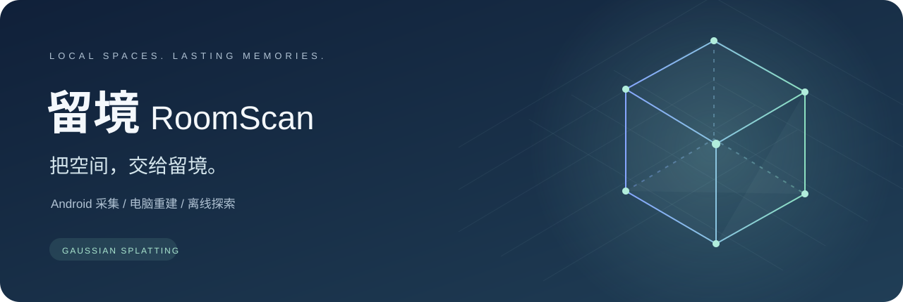
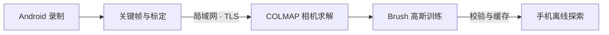

<p align="center"></p>

<p align="center">
  
  
  
  
  
</p>

<p align="center"><b>从一段录制，开始一次空间记录。</b><br>Android 采集 · 局域网重建 · 离线高斯探索</p>

<p align="center"><a href="https://github.com/Gongkddz/RoomScan/actions/workflows/ci.yml"></a></p>

<p align="center"><a href="https://github.com/Gongkddz/RoomScan/releases">下载预览版</a> · <a href="docs/BUILDING.md">从源码构建</a> · <a href="THIRD_PARTY_NOTICES.md">开源致谢</a> · <a href="CHANGELOG.md">更新记录</a></p>

留境 RoomScan 是本地优先的空间重建应用。用手机录制房间、物品或身边的环境，
将自动筛选的关键帧同步到同一局域网的电脑，通过 COLMAP 求解相机位姿、Brush 训练高斯场景，
再把模型保存到手机，用触屏在空间中自由探索。原始视频默认留在手机。

**当前版本：0.6.0-preview。** 已具备采集、同步、重建和离线浏览链路。
精确视觉惯性定位、真实空间 AR 放置、碰撞、大场景 LOD 和覆盖引导仍在开发。

## 下载与开始

源码仓库用于维护源代码、必要资源、测试、构建脚本、文档与许可证。
编译好的 Windows 程序和 Android APK 统一通过 [GitHub Releases](https://github.com/Gongkddz/RoomScan/releases) 分发。

当前预发布版本：[v0.6.0-preview](https://github.com/Gongkddz/RoomScan/releases/tag/v0.6.0-preview)。

| 文件 | 用途 |
| --- | --- |
| [Windows EXE 便携包](https://github.com/Gongkddz/RoomScan/releases/download/v0.6.0-preview/RoomScan-0.6.0-preview-windows-x64.zip) | 包含 EXE、核心服务环境和 Brush，完整解压后使用 |
| [Android APK](https://github.com/Gongkddz/RoomScan/releases/download/v0.6.0-preview/RoomScan-0.6.0-preview-android-arm64.apk) | 签名预览版，Android 12+ / ARM64 |
| [SHA256SUMS.txt](https://github.com/Gongkddz/RoomScan/releases/download/v0.6.0-preview/SHA256SUMS.txt) | 下载文件的 SHA-256 校验值 |
| `RoomScan-0.6.0-preview-source.zip` | 完整项目源码与构建文档 |
| `RoomScan-third-party-sources.zip` | 随附 LGPL 组件的对应源码 |
| GitHub 自动生成的 Source code | 此版本完整项目源码 |

1. 电脑解压 **整个 Windows ZIP** 到可写目录，双击 `RoomScan.exe`。保留 `_internal/` 和 `.tools/`。
2. 手机安装 APK，打开「留境」。手机与电脑连接同一局域网。
3. 首次连接时，扫描电脑窗口中的配对二维码。后续自动发现和重连。
4. 点击「开始扫描」，围绕目标缓慢移动，保持画面重叠与稳定光照。
5. 将记录同步到电脑，等待重建完成。模型下载到手机后即可离线探索。

Windows 版本面向 x64，需要支持 Vulkan/WebGPU 的 GPU 和相应驱动；无需另装 Python 或 CUDA。
首次启动需要联网安装并校验官方 PyCOLMAP 位姿引擎，完成后可离线运行。
EXE 尚无商业代码签名。APK 使用维护者的独立发布密钥签名。
如已安装不同签名的调试版本，请先备份采集数据；Android 通常要求卸载后安装。
防火墙提示时只允许专用局域网访问。端口为 TLS API `8743`，电脑管理页仅绑定 `127.0.0.1:8744`。

## 为记录空间而设计

| 采集 | 连接与计算 | 探索 |
| --- | --- | --- |
| Camera2 兼容路径 | 自动发现电脑与二维码配对 | Spark / Three.js 离线高斯渲染 |
| 系统公开的后置物理镜头选择 | TLS 证书固定与设备凭证 | 浮动摇杆、连续调速与升降 |
| 按传感器画幅选择采集尺寸 | 分块校验、续传与持久任务队列 | 单指转向，多指缩放、旋转与平移 |
| 关键帧筛选、标定和 IMU 记录 | COLMAP + Brush 自动重建 | 横竖屏切换并保留视角 |
| 原始视频本地回看 | 预览、标准与高清独立模型版本 | 模型下载校验与手机缓存 |



镜头可用性由设备公开的 Camera2 能力决定。采集关闭电子与光学防抖，不做数字放大；
预览、视频、关键帧和标定使用同一镜头与尺寸，输出仍受设备管线约束。
当前探索使用触屏移动，采集期间保留 IMU 记录。ARCore 为可选依赖，基础采集使用 Camera2。

## 开发与验证

详见 [构建说明](docs/BUILDING.md)。Python 依赖、前端依赖和 Android 工具链版本均有记录。

```powershell
py -3.12 -m venv .venv
.\.venv\Scripts\python.exe -m pip install -r requirements.lock.txt
.\.venv\Scripts\python.exe -m pip install --no-deps -e .
.\.venv\Scripts\python.exe -m pytest -q
npm.cmd --prefix viewer ci
npm.cmd --prefix viewer test
npm.cmd --prefix viewer run vendor
```

服务端有 22 项测试，查看器有 19 项逻辑测试；Windows 便携版另有隔离启动、二维码、
重建入口和正常退出验证。主要采集测试设备为 Xiaomi 17 Max，
完整重建质量及更多机型兼容性仍需继续验证。

```text
android/       Kotlin 手机应用及离线查看器资源
server/        Python API、身份、存储与重建管线
viewer/        查看器源码、依赖锁与逻辑测试
scripts/       构建、许可收集与验证工具
assets/        统一图标
docs/          构建指南、使用说明与仓库展示资源
licenses/      第三方许可证和依赖清单
```

欢迎按 [贡献指南](CONTRIBUTING.md) 提交问题与改进。

## 数据与隐私

录制、模型和配对信息保存在手机私有目录与电脑的 `.runtime/`，这些内容不进入源码仓库或发布包。
上传默认包含 JPEG、位姿与采集标定，不上传原始视频。当前实现限制每对象 32 MiB、
总输入 1 GiB、每请求 4 MiB，并按设备隔离访问。关闭电脑窗口会停止服务及训练进程。
请在可信局域网使用，详见 [安全说明](SECURITY.md)。

## 许可与致谢

项目原创代码使用 [MIT 许可证](LICENSE)。感谢 [Brush](https://github.com/ArthurBrussee/brush)、
[COLMAP](https://github.com/colmap/colmap)、[Spark](https://github.com/sparkjsdev/spark)、
[Three.js](https://github.com/mrdoob/three.js) 及其他依赖的作者。
第三方代码、SDK 与运行时保留其各自授权；ARCore 适用 Google 的相应条款。
完整组件清单、原始许可文本和研究引用见 [THIRD_PARTY_NOTICES.md](THIRD_PARTY_NOTICES.md)。
